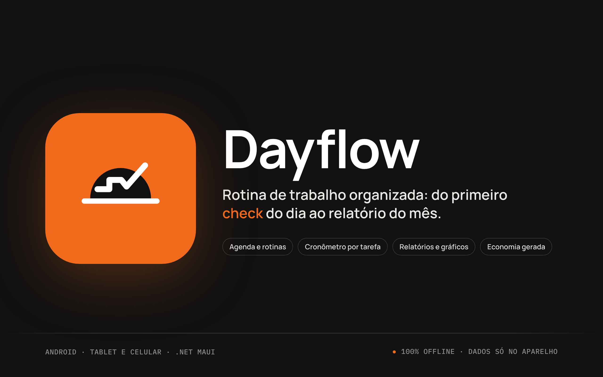
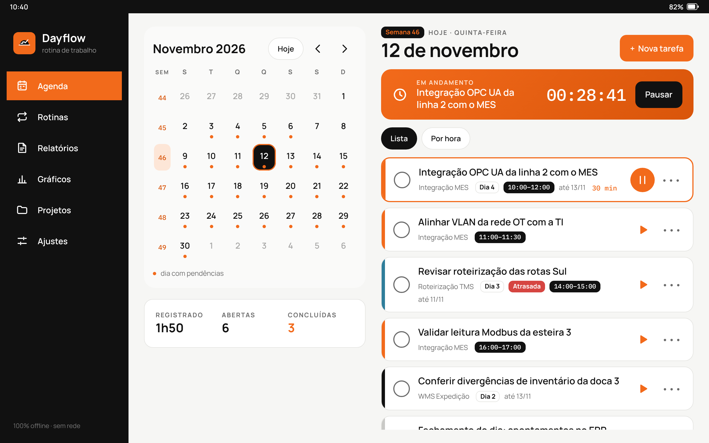
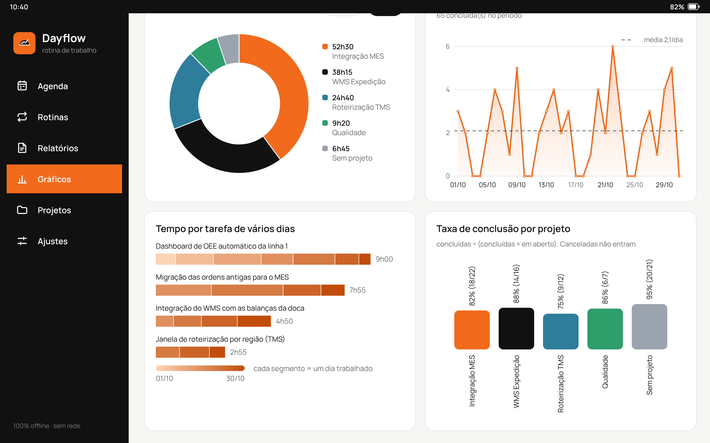

<div align="center">
  <h1>《 Dayflow — Rotina de trabalho offline para Android 》</h1>

  

  <p>Gerenciador de rotina diária de trabalho para Android (tablet primeiro), em .NET MAUI e SQLite local, 100% offline: sem backend, login, sincronização ou telemetria.</p>

  <p>
    
    
    
    
    
    
    
    
  </p>
</div>

## Sumário

- [Sobre o Repositório](#sobre-o-repositório)
- [Projeto](#projeto)
- [Tecnologias](#tecnologias)
- [Como Rodar](#como-rodar)
- [Decisões e Desafios](#decisões-e-desafios)

## Sobre o Repositório

Solução .NET (`Dayflow.slnx`) com três projetos e materiais de apoio:

```
src/Dayflow.Core/          net10.0, sem MAUI (testável em qualquer SO)
  Domain/                  Tarefa, Projeto, Rotina, RegistroDiario, DivisorDeTempo, RelogioCivil, AgendaLembretes
  Data/                    BancoDayflow (conexão serializada + transação), Migracoes/ (PRAGMA user_version), Linhas/
  Services/                Tarefas, Cronometro, Registros, Rotinas, Relatorios (agregações em SQL),
                           Lembretes, Conclusoes, Horarios, ExportadorRelatorio
  Infra/LogArquivo.cs      Microsoft.Extensions.Logging -> arquivo local rotativo (exportável pelo usuário)
src/Dayflow.App/           net10.0-android (produção) + net10.0 (compila XAML/ViewModels sem Android SDK)
  ViewModels/  Views/  Controles/ (gráficos)  Infra/  Platforms/Android/ (manifesto, AlarmManager)
  Resources/Styles/Cores.xaml   tokens de cor
tests/Dayflow.Core.Tests/  xUnit v3, SQLite real em arquivo temporário, relógio e fuso controlados
docs/schema.sql            esquema legível (fonte da verdade: M001_Inicial.cs e migrações seguintes)
docs/mockups/              mockups de tablet e exemplos de exportação
docs/imagens-dados-simulados/  gráficos, relatório mensal (PNG e PDF) e tabela de economia com dados fictícios
docs/linkedin/             prints de divulgação e o HTML/fontes usados para gerá-los
scripts/                   build-android.sh / .ps1, verificar-offline.sh
```

A keystore de assinatura e os APKs não são versionados (ver `.gitignore`).

## Projeto

O Dayflow organiza tarefas, rotinas e tempo trabalhado no dia, e gera relatórios e gráficos a partir desses dados, tudo no próprio aparelho. Telas do `AppShell`: Agenda, Rotinas, Relatórios, Gráficos, Projetos e Ajustes.

<p align="center">
  
  
</p>

### Recursos

- **Agenda**: calendário com número da semana ISO, painel do dia em modo lista ou hora a hora (início em :00/:15/:30/:45), reordenação por dia e badge de tarefa atrasada.
- **Tarefas multi-dia**: a tarefa avulsa aparece de `DataInicio` até `DataConclusao`, ou indefinidamente se aberta, com um registro de tempo por dia trabalhado.
- **Cronômetro persistente**: um ativo por vez, sobrevive a kill e reboot, e fatia o tempo por dia civil ao pausar. Lançamento manual de tempo também disponível.
- **Rotinas**: modelos recorrentes por dia da semana que geram uma tarefa por dia.
- **Projetos**: nome único, cor e arquivamento.
- **Relatório de conclusão e economia gerada**: ao concluir uma tarefa de projeto, registra o que foi feito, quem se beneficia e minutos poupados por pessoas e frequência; a estimativa mensal é calculada em SQL.
- **Relatórios**: KPIs (tempo registrado, média por dia, concluídas, em aberto, taxa de conclusão), barras por projeto, atividades com filtro por situação e tabela de economia. Exporta em PDF (A4), PNG, texto e CSV.
- **Gráficos**: horas por projeto (barras e pizza), concluídas por dia, tempo de tarefas de vários dias (barra empilhada) e taxa de conclusão por projeto, com exportação PNG.
- **Lembretes de hora em hora**: janela configurável (padrão 8h às 18h, seg a sex) com ações *Iniciar próxima* e *Pausar lembretes hoje*.
- **Layout responsivo**: classes de tela em `Infra/Tela.cs` para tablet, celular deitado e celular em pé, com safe area para Android 15+.
- **Saída de dados só por ação explícita**, sempre pela folha de compartilhamento do Android (`ShareFileRequest`), incluindo o log local.

### Modelo de dados

Esquema completo em [`docs/schema.sql`](docs/schema.sql).

| Tabela | Observações |
| --- | --- |
| `Projeto` | `Nome` único (NOCASE), `Cor` `#RRGGBB`, `Ativo` (arquivar). Exclusão só sem tarefas. |
| `Tarefa` | `ProjetoId?`, `RotinaId?`, datas como dia civil (`DateOnly.DayNumber`), `Status` 0..3. CHECKs garantem `Status final ⇔ DataConclusao`. |
| `RegistroDiario` | UNIQUE `(Data, TarefaId)`: um registro por dia trabalhado. `SegundosResiduais` (0..59) evita perder sessões curtas. |
| `Rotina` | Modelo recorrente (bitmask de dias). Gera uma `Tarefa` por dia (UNIQUE `(RotinaId, DataInicio)`). |
| `OrdemDia` | Reordenação por dia `(Data, TarefaId, Posicao)`. Dia sem ordem herda a do último dia ordenado. |
| `CronometroAtivo` | No máximo uma linha (`CHECK Id = 1`). |
| `RelatorioConclusao` | Relatório de conclusão e economia gerada (migração M002). |
| `HorarioDia` | Horário e duração planejados da tarefa no dia (migração M003), excluído em cascata. |

### Relatórios e gráficos em SQL

Todas as agregações estão em `ServicoRelatorios` e `ServicoConclusoes` como constantes SQL; o C# só mapeia o resultado.

| Gráfico | Consulta |
| --- | --- |
| Horas por projeto (barras e pizza) | `SqlHorasPorProjeto`: `SUM(TempoGastoMin) ... GROUP BY t.ProjetoId` |
| Concluídas por dia (linha) | `SqlConcluidasPorDia`: CTE recursivo de dias com `LEFT JOIN Tarefa`, dias zerados incluídos |
| Tempo por tarefa de vários dias (empilhada) | `SqlTempoTarefasMultiDia`: `GROUP BY TarefaId, Data` para tarefas com dois ou mais dias (top 10) |
| Taxa de conclusão por projeto | `SqlTaxaConclusao`: `SUM(CASE ...)` por projeto |
| Marcação do calendário | `SqlCalendario`: pendentes ao fim de cada dia do mês |
| Economia por projeto | `SqlEconomiaPorProjeto`: `GROUP BY t.ProjetoId` com fatores mensais fixos |

### Identidade visual

- **Paleta**: preto `#111111`, laranja `#F26A1B`, branco `#FFFFFF`, centralizados nos três `Base*` de `Resources/Styles/Cores.xaml`. Os hex são provisórios até um guia oficial.
- **Tipografia**: Manrope (texto) e IBM Plex Mono (cronômetro), ambas OFL e embutidas no APK (`Resources/Fonts/LICENCAS.txt`).
- **Logo**: sol laranja nascendo no horizonte e traço que sobe e termina em check (`Resources/AppIcon/appiconfg.svg`).

### Histórico de versões

| Versão | Principais mudanças |
| --- | --- |
| 1.1 | Relatório de conclusão e economia gerada; exportação dos gráficos em PNG. |
| 1.1.2 | Correção do app que não abria nos APKs 1.0.0 a 1.1.1 (ver Decisões e Desafios). |
| 1.3.0 | Semana ISO no calendário, dia hora a hora (`HorarioDia`), relatórios redesenhados, exportação em PDF/PNG/texto/CSV. |
| 1.3.1 | Ajustes de layout para celular em pé e deitado. |
| 1.3.2 | Desempenho: recarga só de telas visíveis, rajadas agrupadas, listas em lote, consulta de calendário pré-filtrada (cerca de 9x mais rápida com 1 ano de histórico), log em segundo plano. |
| 1.4.0 | Layout responsivo por classe de tela (referência POCO X7 Pro, cerca de 443x986 dp), trilho só com ícones no celular deitado, calendário recolhido na semana em pé, safe area Android 15+, nova keystore de assinatura. |
| 1.4.1 | Tudo visível em pé no celular: tabelas de economia viram cartões abaixo de 600 dp, textos quebram linha em vez de cortar, rótulos de gráfico em dp. |

### Limitações conhecidas

- Lembretes usam alarme inexato: atraso de alguns minutos é esperado.
- O ícone de notificação usa o traço do relógio (monocromático, como o Android exige).
- Quem tem a 1.3.x instalada precisa desinstalar antes de instalar a 1.4.x, porque a chave de assinatura mudou; como o backup está desligado, os dados locais são perdidos.

## Tecnologias

### Mobile

| Tecnologia | Uso |
| --- | --- |
| .NET MAUI 10 (`net10.0-android`) | App Android, XAML compilado (`MauiStrictXamlCompilation`), API mínima 26 e alvo 36 |
| CommunityToolkit.Mvvm 8.4 | ViewModels (MVVM) |
| SkiaSharp.Views.Maui.Controls 3.119 | Desenho de gráficos, barra empilhada própria e exportação PNG/PDF |
| Microcharts.Core 2.0 | Núcleo de barras, donut e linha (a View é própria, com captura de erro) |
| AlarmManager (Android) | Lembretes de hora em hora com alarme inexato |

### Back-end

| Tecnologia | Uso |
| --- | --- |
| C# / .NET 10 (`net10.0`) | `Dayflow.Core`: domínio, dados e serviços, sem dependência de MAUI |
| Microsoft.Extensions.Logging 10 | Log local rotativo em arquivo, exportável pelo usuário |
| Microsoft.Extensions.DependencyInjection.Abstractions 10 | Registro dos serviços do núcleo |

### Dados

| Tecnologia | Uso |
| --- | --- |
| sqlite-net-pcl 1.11 (SQLitePCLRaw 3, SQLite 3.53) | Banco local, migrações por `PRAGMA user_version`, agregações em SQL |

### Infraestrutura

| Tecnologia | Uso |
| --- | --- |
| xUnit v3 3.1 + Microsoft.NET.Test.Sdk 18 | 61 casos `[Fact]`/`[Theory]` cobrindo multi-dia, rotinas, cronômetro (meia-noite, DST de São Paulo, fuso +14), relatórios, CSV, lembretes, esquema e rollback |
| R8, AOT guiado por perfil, trim | Build Release enxuto (cerca de 20 MB por APK arm64) |
| Scripts Bash e PowerShell | Build, testes e verificação offline do APK |

## Como Rodar

### Pré-requisitos

- .NET SDK 10 (`global.json` fixa `10.0.100` com `rollForward: latestFeature`)
- Workload MAUI Android: `dotnet workload install maui-android`
- Android SDK (platform 36 + build-tools) e JDK 21. O Visual Studio com a carga MAUI instala tudo.

### Passos

1. Clonar o repositório:

```bash
git clone https://github.com/GZimbra/Dayflow.git
cd Dayflow
```

2. Rodar os testes do núcleo (qualquer SO):

```bash
dotnet test tests/Dayflow.Core.Tests
```

3. Gerar o APK Release (arm64), que roda os testes e a verificação offline no final:

```bash
scripts/build-android.sh
```

No Windows (PowerShell 7+):

```powershell
pwsh scripts/build-android.ps1
```

Opções: `-p:DayflowAbis="android-arm64%3Bandroid-x64"` inclui x64 para emulador e `-p:DayflowFormatos=aab` gera AAB.

4. Assinar com a própria chave (recomendado para distribuir). Sem estas variáveis o build usa a chave de debug:

```bash
keytool -genkeypair -v -keystore dayflow.keystore -alias dayflow -keyalg RSA -keysize 4096 -validity 10000
DAYFLOW_KEYSTORE=$PWD/dayflow.keystore DAYFLOW_KEY_ALIAS=dayflow DAYFLOW_KEY_PASS=<senha> scripts/build-android.sh
```

| Variável | Uso |
| --- | --- |
| `DAYFLOW_KEYSTORE` | Caminho da keystore |
| `DAYFLOW_KEY_ALIAS` | Alias da chave |
| `DAYFLOW_KEY_PASS` | Senha da store e da chave |

Saída: `src/Dayflow.App/bin/Release/net10.0-android/publish/com.dayflow.app-Signed.apk`.

5. Verificar um APK já gerado:

```bash
scripts/verificar-offline.sh caminho/para/app.apk
```

O script falha se encontrar permissão de rede, telemetria ou alarme exato, backup habilitado ou SDKs como Firebase, App Center, Sentry, Play Services ou OkHttp. Fica como verificação manual no aparelho: em Configurações, Apps, Dayflow, Permissões, não deve aparecer "Rede", e todas as telas devem funcionar em modo avião.

## Decisões e Desafios

<details>
<summary>App 100% offline, verificado no build</summary>

O Release não declara `INTERNET` (`AndroidNeedsInternetPermission=false`) e o manifesto remove via `tools:node="remove"` permissões de rede, `AD_ID`, `c2dm` e alarme exato, inclusive as que viriam de bibliotecas (por isso `AndroidManifestMerger=manifestmerger.jar`). O APK final só tem `POST_NOTIFICATIONS`, `RECEIVE_BOOT_COMPLETED` e a permissão de receiver do AndroidX. Backup desligado em todas as APIs (`allowBackup=false`, `fullBackupContent` e `dataExtractionRules` para `cloud-backup` e `device-transfer`), `usesCleartextTraffic=false` e feature switches do .NET que removem caminhos de rede do BCL. Logs não guardam dados pessoais: só IDs, contagens e tipo/HResult/stack das exceções. O Debug usa outro manifesto, porque o depurador .NET precisa de socket local. O custo é não haver sincronização nem backup: trocar de aparelho ou reinstalar perde os dados.

</details>

<details>
<summary>Dia civil e cronômetro fatiado por dia</summary>

O dia civil é o do fuso do aparelho no momento do evento, gravado como `DateOnly`; viagens não recalculam o passado. Ao pausar, o intervalo UTC é dividido por dia civil (`DivisorDeTempo`): 23:30 a 00:40 vira 30 min no dia D e 40 min no D+1, com tratamento de meia-noite inexistente ou ambígua no horário de verão. Há limite de 24 h por tarefa por dia e o relógio voltando no tempo descarta a sessão. `TimeProvider` é injetado para que os testes controlem relógio e fuso.

</details>

<details>
<summary>Mesma regra de visibilidade em C# e em SQL</summary>

A regra de carry-over (tarefa visível de `DataInicio` até `DataConclusao`) existe em `Tarefa.VisivelEm` e em `ConsultasSql.FiltroVisivelNoDia`. Um teste de equivalência sobre dados aleatórios garante que as duas não divergem, o que permite manter as agregações no SQLite sem perder a regra de domínio.

</details>

<details>
<summary>Agregações no SQLite e escrita transacional</summary>

Relatórios e gráficos usam `GROUP BY` no SQLite e o C# só mapeia. Toda escrita passa por `BancoDayflow.EscreverAsync` dentro de `RunInTransaction`, com rollback total em falha (teste `Escrita_que_falha_faz_rollback_completo`). Taxa de conclusão = concluídas / (concluídas + abertas ao fim do período), com canceladas fora do denominador; relatórios classificam pela situação naquele período. Semana segue ISO (segunda a domingo).

</details>

<details>
<summary>Rotinas valem só para o próprio dia</summary>

A instância de rotina é criada ao abrir o dia (hoje ou passado) e não acumula. Dias futuros mostram "rotinas previstas" sem gravar. A instância não pode ser excluída, porque seria recriada; o caminho é cancelar ou pausar a rotina.

</details>

<details>
<summary>CSV compatível com Excel pt-BR e seguro</summary>

Separador `;`, UTF-8 com BOM, RFC 4180 e neutralização de fórmulas iniciadas por `=`, `+`, `-` ou `@`, para que um título de tarefa não vire fórmula ao abrir a planilha.

</details>

<details>
<summary>Correção 1.1.2: o app não abria</summary>

Os APKs 1.0.0 a 1.1.1 foram gerados com um `android.jar` substituto sem as classes `java.*`. O R8, com `-ignorewarnings`, não reconheceu `java.lang.Runnable` como biblioteca e removeu `run()` de 167 classes do AndroidX, o que causava `AbstractMethodError` antes do .NET iniciar. A 1.1.2 passou a usar `android.jar` + `java.base` e foi conferida por inspeção do dex (zero implementações faltando). Com o Android SDK oficial o problema não ocorre.

</details>

<details>
<summary>AOT por perfil sem remover o IL</summary>

O Release usa AOT guiado por perfil (início rápido sem o tamanho do AOT completo), R8 e trim parcial, só para arm64. `AndroidStripILAfterAOT` fica desligado: com AOT por perfil, métodos fora do perfil ficariam sem IL e o app fecharia ao abrir. O trim completo continua opt-in (`-p:TrimMode=full`).

</details>

<details>
<summary>sqlite-net 1.11 por causa de advisory no e_sqlite3</summary>

A linha 1.11.x usa SQLitePCLRaw 3 e SourceGear.sqlite3 (SQLite 3.53, nativo alinhado a 16 KB para Android). A linha 2.1.x do `e_sqlite3` tem o advisory GHSA-2m69-gcr7-jv3q, por isso o `bundle_green` não é usado.

</details>

<details>
<summary>Layout por classe de tela, não por aparelho</summary>

A 1.4.0 trocou ajustes pontuais por classes de tela em `Infra/Tela.cs` (largura compacta abaixo de 600 dp, altura baixa abaixo de 520 dp, celular quando o menor lado fica abaixo de 600 dp). Fontes de título e alturas de gráfico viraram `DynamicResource`, e o `AppShell` atualiza `TelaEstreita`/`TelaLarga` ao girar. Na 1.4.1 a prioridade passou a ser não cortar informação: tabelas viram cartões e textos quebram linha em vez de usar reticências.

</details>

---

Desenvolvido por [GZimbra](https://github.com/GZimbra).
